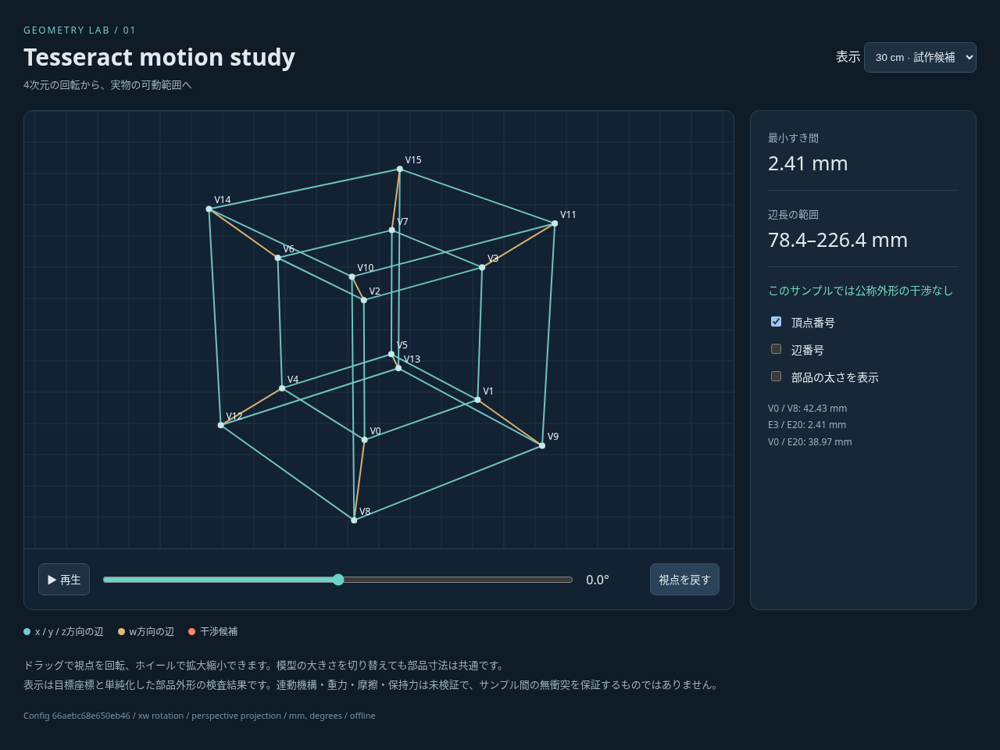

# Tesseract

4次元超立方体（テッセラクト）の回転を3次元へ投影し、その変形を実物の可動模型で再現するプロジェクト。

数学・機構設計・部品試作を往復し、AIが計算、パラメータ探索、CAD生成、検証に介入できる制作環境を目指す。

## 現在の状態

数学モデル、干渉検査、オフライン可視化、試作用CAD生成を実装した。実物の測定結果はまだない。

最終目標は約15 cm。まず必要なら約30 cmで検証する。手動で変形させ、固定機構や支持台を利用できる。家庭用FDMの設備は前提とせず、市販材・外注造形・加工サービスを比較する。



[生成例・分析結果](examples/README.md) / [ビューア・CAD一式をダウンロード](examples/default-pack.zip) / [製作方法の比較](docs/manufacturing.md)

ZIPを展開した`viewer.html`をブラウザで開くと、回転角・視点・サイズ・部品外形の表示を操作できる。ネット接続やサーバーは不要。

## 実行方法

Python 3.12以上を使用する。

CAD用の依存関係は、動作確認したbuild123d 0.10.0とocp-gordon 0.1.18を指定している。`.[cad]`で対応する組み合わせを導入する。

```bash
python3.12 -m venv .venv
source .venv/bin/activate
python -m pip install -e '.[cad]'
python -m tesseract all --config config/default.toml --output output
```

Windowsでは仮想環境の有効化に`.venv\Scripts\activate`を使う。CADが不要なら`python -m pip install -e .`で導入し、`render`まで実行できる。

```bash
tesseract analyze --config config/default.toml --output output
tesseract render --config config/default.toml --output output
tesseract cad --config config/default.toml --output output
python -m unittest discover -s tests -v
```

`uv`を使う場合は`uv run --extra cad tesseract all --config config/default.toml --output output`でも生成できる。

| 操作 | 出力 |
| --- | --- |
| `analyze` | 全周・候補区間を両サイズで分析。`analysis.json`、設定スナップショット、辺ごと・角度ごとのCSV、`report.md` |
| `render` | 分析結果に加え、オフライン`viewer.html`、要求グラフ`requirements.png`、姿勢例`motion.png` |
| `cad` | 分析結果に加え、`cad/`内に各部品のSTEP/STL、部品表、組立・測定手順、寸法と再検査の記録 |
| `all` | 上記すべて |

各操作は渡された設定から再計算する。過去の分析ファイルを暗黙に使わない。単位はmm・度、力の実測はN。すき間は片側・半径・直径の別を設定コメントで明示する。

配布用ZIPを更新する場合は、`all`で生成した後に`python scripts/package_example.py --output output`を実行する。設定IDと可視化ファイルのハッシュを検証し、異なる設定の分析・CAD・可視化が混在した場合は梱包を中止する。

### 初期計算で分かったこと

xw回転、投影距離4の透視投影、候補区間−15°〜＋15°、0.1°刻みの結果。部品寸法は両サイズで共通。

| 外形上限 | 辺の長さ | 公称外形の最小すき間 | 干渉候補サンプル | 二段伸縮の収納・ストローク適合 |
| --- | --- | --- | --- | --- |
| 300 mm | 70.51〜244.75 mm | −1.49 mm | 152/301 | 24/32辺 |
| 150 mm | 30.45〜105.69 mm | −5.55 mm | 301/301 | 12/32辺 |

30 cmの公称外形で干渉がなかった連続サンプル群は−7.4°〜＋7.4°。これはサンプル間を含む可動保証ではない。締付けボスとねじ頭を含めて棒の外形を保守的に広げたCAD後の検査では、両サイズとも全候補サンプルが干渉候補になる。実配置を反映した設計変更が必要。

CADは、伸縮辺1本、球＋分割ソケット、静的な4辺配置ゲージ、すき間比較片の計10部品。伸縮試験片はE21の必要範囲に対応する。球面接続は1方向の形状検査で10°まで干渉せず、15°で接触する。最終的な可動ハブや辺とのアダプタは未設計で、これらを組めば模型全体が成立するという意味ではない。

設定と生成例の詳しい数値は[分析結果](examples/README.md)を参照する。製作前に加工方式別の制約と公差を確認する。

### 可視化・CADの検証

数学・距離計算・設定・部品の有効性・STEP再読込・STL・伸縮端での干渉について標準ライブラリの`unittest`で検証する。CAD未導入時はCADテストをスキップする。

ブラウザの追加確認は、PlaywrightとChromiumを導入した環境で行える。

```bash
python -m pip install playwright
python -m playwright install chromium
python tests/browser_smoke.py output/viewer.html --screenshot output/viewer.png
```

回転角、再生・停止、表示切替、視点操作、スマートフォン幅、外部通信なしを確認する。システムのChromiumを使う場合は`CHROMIUM_EXECUTABLE`を指定できる。

GitHub Actionsでも数学・CAD・生成・ブラウザ操作を検証し、生成ファイル一式を成果物として保存する。

過去チャットは目的と条件の把握に用いる。制作手段、ソフトウェア、材料、寸法、製作順序は検証結果に応じて選び直す。

## 制作目標

- 16頂点・32辺からなるテッセラクトの3D投影を、実物模型として再現する。
- 代表的な4D回転について、途中の姿勢を含めて連続的に変形できる構造を作る。
- 計算上の目標軌道と実物の動きを比較し、可動範囲・干渉・操作力を評価できるようにする。
- 設計データ、部品表、組立手順、測定結果を残し、修理・再製作できるようにする。

最初の完成目標は「選んだ1種類の4D回転について、限定した範囲を連続して変形できる模型」とする案を出発点にする。任意の回転すべてへの対応は、初期要件に含めない。

### 未確定の完成仕様

以下は過去の検討案を含む。優先順位と数値は、試作前に仮決定する。

| 項目 | 決めること |
| --- | --- |
| 再現する動き | 回転平面、角度範囲、投影方法、基準姿勢 |
| サイズ | 模型と可動範囲の上限、ロッド・ハブの寸法 |
| 操作 | 手動か電動か、何か所を操作するか |
| 支持 | 自立、台座、吊り下げなどを許容するか |
| 保持 | 手を離した姿勢を保持する必要性と保持時間 |
| 精度 | 理想投影に対する許容誤差と測定方法 |
| 耐久性 | 想定する操作回数、交換可能にする部品 |
| 制作条件 | 予算上限、利用できる設備、作業時間 |

過去案の一辺100 mmなどの寸法や、4〜6か月という期間は確定値として扱わない。必要な動きと部品試験の結果から見積もり直す。

## 主要な課題

| 課題 | 検証すること |
| --- | --- |
| 投影と実物の干渉 | 投影では頂点や辺が重なる場合がある。太さのあるロッド・ハブでも経路を通過できるか |
| 辺の伸縮 | 最短・最長長さ、収納長、必要な重なり長さ、抜け止め、ガタを両立できるか |
| 頂点ジョイント | 1頂点に集まる4辺の角度変化、回転軸、取付位置、ねじれを許容できるか |
| 自由度と連動 | 余計な変形を抑え、狙った操作で目標軌道を通れるか |
| 操作と保持 | 摩擦、ロック、支持、駆動をどう組み合わせ、操作力と保持力を両立するか |
| 閉ループ | 部品を輪状につないだ際の拘束、組立誤差、引っ掛かりを扱えるか |
| 製造・交換 | 公差、摩擦のばらつき、強度、組立順序、部品交換に対応できるか |

次の4点は別々に確認する。

1. 必要な形になれる。
2. そこまで連続して動ける。
3. 狙った入力・操作で動かせる。
4. 指定した支持条件で形を保持できる。

自由な伸縮辺とジョイントを接続するだけでは、4D回転に沿って連動する機構にはならない。理想座標を強制的に与えるアニメーションも、実物の機構が成立する証明とは区別する。

立方体の試作は、伸縮・保持・組立の検証に使える。ただし立方体は1頂点3辺、テッセラクトは4辺なので、4辺ハブとその周辺構造も別途検証する。

## 制作計画

| 段階 | 作業・成果物 | 次に進む判断基準 |
| --- | --- | --- |
| 1. 完成仕様 | 目標の変形動画または図、操作・支持・保持条件、予算をまとめる | 完成を判定できる仕様がある |
| 2. 数学・幾何の確認 | 回転と投影を計算し、辺長・角度・部品間距離を調べる | 太さのある部品で通れそうな経路がある |
| 3. 小さな機構比較 | 伸縮辺、ジョイント、保持方法、はめ合い試験片を少量試作する | 必要な可動範囲を満たし、操作力と保持力を測れる |
| 4. 部分構造の検証 | 立方体、4辺ハブ、閉ループを含む部分構造を試す | 複数部品を組んでも動作が成立する |
| 5. 連動機構の設計 | 手動調整、リンク、ワイヤ、ガイド、電動を比較する | 狙った入力で目的の経路を通れる |
| 6. 全体製作・評価 | 16頂点・32辺を組み、精度・保持・操作力・耐久性を確認する | 完成仕様を満たし、修理・再製作できる |

段階2で経路が成立しない場合は、投影方法、回転範囲、サイズ、部品配置を見直す。端点の姿勢だけでなく、途中の姿勢も調べる。

シミュレーションと実物試験は往復させる。寸法、質量、摩擦、ガタを実測し、その値を計算モデルへ戻す。伸縮方向の抵抗と回転方向の抵抗は分けて記録する。

各段階の結果を受けて、予算・期間・構造を更新する。全体製作や32辺分の部品調達は、部分試作の結果を確認してから進める。

## 設計・検証環境の方針

- 最初はPythonによる数学計算と簡単な3D表示から始め、必要な辺長・角度・干渉を数値化する。
- 数学、CAD、物理モデルで頂点・辺・部品番号、寸法、接続位置を共有する。mmとm、角度の単位などの変換を明示する。
- CADはコードからの生成・修正ができる構成を候補にする。build123dはSTEP・STLへの出力に対応する。[公式資料](https://build123d.readthedocs.io/en/latest/import_export.html)
- 物理エンジンは、必要な拘束と実測結果を小さな試験機構で再現できるかを確認して選ぶ。MuJoCoとProject Chronoは比較候補であり、導入・併用を必須にしない。[MuJoCo公式資料](https://mujoco.readthedocs.io/en/stable/computation/index.html)・[Project Chrono公式資料](https://api.projectchrono.org/tutorial_table_of_content_chrono.html)
- 専用シミュレータの完成を先行目標にせず、個々の設計判断に必要な計算・表示を追加する。
- CAD上の接続・配置と、重力・摩擦・保持力の物理検証は区別する。

## 前例・参考資料

### Round About Four Dimensions

Julius von BismarckとBenjamin Mausによる2023年の可動作品。CERN Science Gatewayに設置され、4D回転の3D投影を実物化している。約2.3 m角で、金属・樹脂・電子機器を使用する。

実現可能性と動きの参考にする。小型・手動模型で同じ機構が成立するかは、別途検証する。

- [CERN公式紹介](https://arts.cern/commission/round-about-four-dimensions/)
- [制作者の記録・動画](https://www.allesblinkt.com/projects/round-about-four-dimensions/)

過去チャットの「自由度過多で苦労し、1軸ジョイントを採用した」という説明は、今回確認した上記の一次資料では裏付けられていない。機構選定の根拠には含めない。

### Fourmilab Tesseract

4D図形を仮想3D空間へ投影し、回転させる公開実装。目標の動きや表示方法の参考にする。実物の摩擦・保持・干渉を解決する前例とは分けて扱う。

- [公開コード](https://github.com/Fourmilab/tesseract)

### 目的整理に参照したチャット

- [テッセラクト制作計画を立てる](thread://01a162dd-c872-72d3-aeef-590bdcaf67a8?hostId=local)
- [4次元立方体投影作成](chatgpt-conversation://6ac36bed-f2a8-83ee-9bd3-7965242d3ae5)
- [立方体物理シミュレータ設計](chatgpt-conversation://6aad557c-528c-83ee-b884-c125a24c9b52)

チャットのリンクは対応アプリ内で参照する。チャット中の提案は、実装済み・実測済みの事実として扱わない。

## 必要な準備

| 分類 | 準備するもの |
| --- | --- |
| 仕様 | 代表的な変形の図または動画、サイズ・予算上限、操作・支持・保持条件 |
| 計算環境 | Python、数値計算、簡単な3D表示、設計データの変更履歴 |
| 設計データ | 頂点・辺の番号、単位、寸法、部品接続位置、試験条件の共通管理 |
| 試作手段 | 3Dプリントの利用先、棒・管材・ねじなどの少量調達、組立工具 |
| 測定手段 | ノギス、重量計、ばねばかりなど。寸法・質量・動き始める力・保持力を記録する |
| 試験記録 | CADと試験片の版、材料、製作条件、測定値、動作動画、不具合と改善内容 |

## 次に取り組むこと

- [x] 初期の回転・投影・サイズ・候補区間を仮設定する。
- [x] 16頂点・32辺の数学モデルと操作可能な投影アニメーションを作る。
- [x] 辺長・角度・公称部品外形の干渉を調べ、15 cmと30 cmを比較する。
- [x] 伸縮辺・球面接続・配置ゲージ・比較片の実験用CADと製作方法の比較を用意する。
- [ ] 短い8辺の収納と、ジョイントの可動域・4辺ハブ・締結部配置を再設計する。
- [ ] 外注先・市販材を選び、見積もりと受入条件を確認する。
- [ ] 比較試験片を少量製作し、可動範囲・操作力・保持力・ガタを測る。

最初の到達点は「目標の変形動画」「辺長・角度・干渉の要求一覧」「伸縮辺とジョイントの比較試験結果」がそろうこと。その結果から全体模型の構造、製作費、期間を具体化する。
