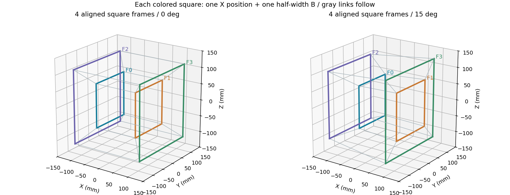
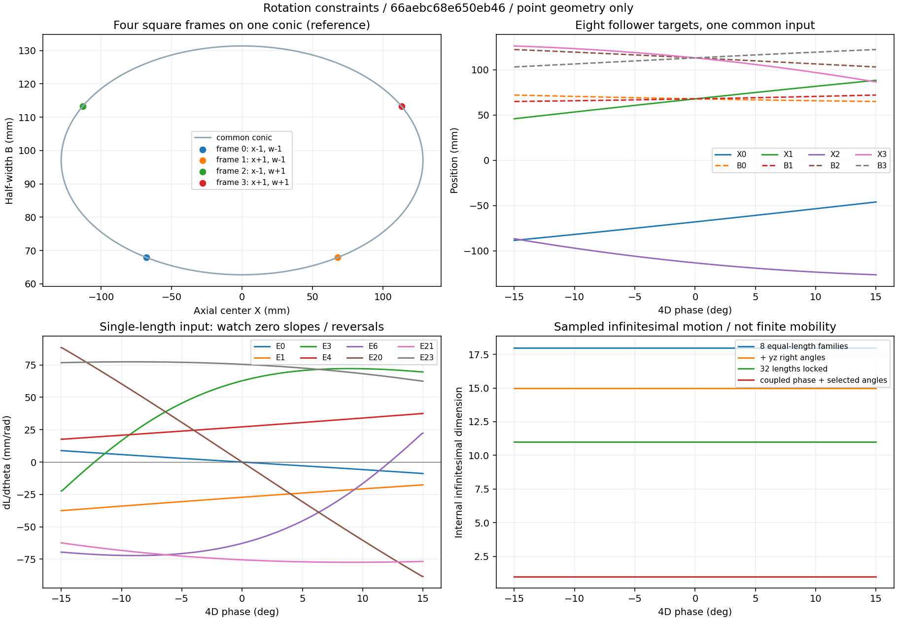

# 自然に4D回転へ沿わせるための拘束

## 結論と対象

**長さ・角度の上下限を増やすだけでは、目標の回転には沿わない。複数の長さ・角度を、共通の回転位相に結び付ける必要がある。** 摩擦は姿勢保持に使えるが、変形経路を選ぶ拘束の代わりにはならない。

まず現行の「xw平面の回転・距離4の透視投影」を対象とし、下記の順で設計することを提案する。

1. 16頂点を、向きのそろった**拡縮する4枚の正方形枠**にまとめる。
2. 枠の向き・中心線・正方形を維持するガイドを設ける。
3. 各枠の位置と大きさを、**同じ1つの回転位相**で連動させる。
4. x/w方向の接続辺は、枠の変形に追従する伸縮リンクとして扱う。
5. 入力軸側で保持・抵抗を調整する。

これは幾何学上の構成案で、製造可能な連動機構の完成ではない。既存CADの干渉・収納不足は、この検討では解決していない。

## 1. 上下限と、経路を作る等式の違い

`Lmin ≤ L ≤ Lmax` や `αmin ≤ α ≤ αmax` は、端に達するまで余計な変形を止めない。対して `L_i = f_i(θ)` は、ある辺を動かしたときに他の辺がどこへ動くべきかを結び付ける。

実際、既定のモデルをθ=0°で**0.999倍に縮める**と、32辺はすべて候補区間の長さ制限内に入り、96組の辺間角度は完全に同じまま、8種類の同長条件も保たれる。しかし、決まったスケールの4D回転軌道からは外れる。`constraints.json`に数値による反例を記録した。

ばねや摩擦を各部に独立に追加しても、全体を同じ位相へそろえる関係は生まれない。ばねは特定の姿勢へ戻し、摩擦は不適切な姿勢も保持し得る。目標は、経路の横方向を拘束し、経路に沿う方向は動かしやすくすること。

## 2. 点モデルで残る自由度を調べる

16頂点の座標は48成分。全体の並進・回転6成分を除くと、内部形状は42成分ある。以下は**目標姿勢でのヤコビ行列の階数から求めた、一次の微小変形の次元**。既定の候補区間301姿勢と全周361姿勢で確認した。

| 仮定した拘束 | 階数 | 残る内部の微小変形 |
| --- | ---: | ---: |
| 各辺が自由に伸縮、角度自由 | 0 | 42 |
| 8種類の辺長をそれぞれ同長にする | 24 | 18 |
| 上記＋各頂点のy/z辺を直角に保つ | 27 | 15 |
| 32辺をその姿勢の長さで固定する | 31 | 11 |
| 32辺長＋選んだ11組の角度を共通θの関数にする | 42 | 1（θも変数として数える） |

32本の辺を固定した行の「11」は有限の可動自由度の証明ではない。理想投影姿勢は特別な配置で、少し乱した配置では辺長ヤコビ行列の階数が32になることもテストした。特異配置の一次運動と、実際に有限距離だけ動けることは区別する。

最後の行は、位相θを追加した49変数に対する階数42なので、全体の剛体運動6を除いて1次元が残るという診断。11組は独立な**角度のスカラー条件**の一例であり、「11個のヒンジ／モーターを付ければよい」という意味ではない。目標角度自体がθで変わるため、固定角ストッパーで置き換えることもできない。選択した頂点・辺番号は生成JSONに残す。

独立な配置拘束と自由度、特異点での階数の変化という考え方は[Modern Robotics 2.4](https://modernrobotics.northwestern.edu/nu-gm-book-resource/2-4-configuration-and-velocity-constraints/)・[5.3](https://modernrobotics.northwestern.edu/nu-gm-book-resource/5-3-singularities/)を参照。以下のテッセラクトへの分解・式・数値は、このリポジトリで導出・検証したもの。

## 3. 4枚の正方形で表す

元の頂点を `(sx, sy, sz, sw)`、各符号を±1、回転位相をθ、透視距離をd、固定スケールをSとする。xw回転後は

```text
x' = sx cosθ − sw sinθ
w' = sx sinθ + sw cosθ
B  = S d / (d − w')
X  = B x'
3D頂点 = (X, sy B, sz B)
```

`(sx, sw)`を固定すると、`sy, sz`の4通りがYZ平面に平行な正方形を作る。各枠は、中心のX位置と半幅Bの2変数だけで表せる。4枚で合計8変数となる。

- y/z方向の16辺：各枠で4辺が同長の`2B`。4グループ。
- x方向の8辺：swごとに4辺が同長。2グループ。
- w方向の8辺：sxごとに4辺が同長。2グループ。

接続辺の長さは、対応する枠i,jに対して `sqrt((Xi−Xj)² + 2(Bi−Bj)²)`。8種類の辺長は独立な8入力ではなく、すべて同じθから決まる。





### 角度の拘束を機構へ読み替える

枠内のy/z辺は、直角と四辺同長を保ちながら伸縮する必要がある。単に四角形を4本の自由な棒で組むのではなく、直角スライド、パンタグラフ、中心対称ガイドなどで正方形を維持する。

各頂点でx/wの接続リンクは、**X方向と、その頂点のYZ対角方向が張る同じ平面**内を動く。その法線は `(0, sz, −sy)` に平行になる。このため、枠の向きを保てれば、各接続リンクの端は自由球面ジョイントより、法線方向の軸を持つ1軸ヒンジに整理できる。二つのリンクはそれぞれ回転可能にする必要があり、互いに固定しない。

この軸の結論は、xw回転を正方形枠に分解した結果であり、先行作品の機構を推測したものではない。ピンやリンクの厚み、軸の積み重ね、枠の案内部との接続を加えると頂点位置がずれるため、実形状での再計算が必要になる。

## 4. 4枚を同期させる7つの条件

まず4枚の枠は、同じ中心線と向きに案内されていると仮定する。各枠は位置Xと半幅Bを持つので8変数ある。

回転前のxw座標が±1であることから `x'²+w'²=2`。したがって各枠に

```text
X² + d²(B−S)² = 2B²
```

という条件が1つずつあり、合計4条件になる。d>√2なら、これは(X,B)平面上の楕円。しかし、**4点を同じ楕円に乗せただけでは、4点が独立に動く**。

さらに各枠から回転位相を復元する。

```text
x' = X/B
w' = d(1−S/B)
c  = (sx x' + sw w')/2
s  = (sx w' − sw x')/2
θ  = atan2(s, c)
```

4組の(c,s)を同じにする。独立な位相合わせは3条件なので、合計7条件、8−7=1自由度となる。実装では4本の単位円条件と3本の位相外積条件を使い、基準位相との内積が正であることも確認する。内積条件がないと、180°違う別の組立枝も等式を満たしてしまう。

**楕円上の見た目の角度を90°ずつずらすだけでは正しくない。** 透視投影により、楕円上の媒介角と元の4D回転位相は異なる。共通軸を使う場合も、上式のX(θ),B(θ)を使う。

### 最初に検討する連動方式

支持台上の共通入力軸から、4枠のX位置とBをガイド・カムで与える構成を、幾何学的な基準案とする。出力座標は8個でも、入力は1軸にまとめられる。`cam_profiles.csv`に30 cm・15 cmの両方の8出力を記録する。

これは**カムの輪郭そのものではなく、従動節の目標変位**。実際の輪郭には基礎円、従動節形状、圧力角、予圧、干渉、バックラッシュの設計が必要。入力軸のロックや軽い抵抗で姿勢を保持できる構成を目指すが、必要なトルク・保持力は未計算。

カム方式が小型化に不利なら、同じ目標変位を満たすリンクやワイヤの組み合わせを探索する。ただしワイヤの等長化だけでは、非線形な位相関係まで自動的には実現しない。次の具体試作は、全32辺ではなく「枠1枚の拡縮＋位置案内」と「2枠の位相同期」に絞る。

## 5. どこを手で動かすか

入力寸法をuとすると、局所的には `dθ ≈ du / (du/dθ)`。傾きがゼロになる箇所は、寸法から回転方向を選べず、伝達比や操作力の検討でも問題になる。力の関係は他の拘束・摩擦・荷重を含めて評価する必要がある。

既定の±15°区間では、次の結果になった。

| 入力候補 | 結果 | 初期案での扱い |
| --- | --- | --- |
| x接続辺（代表E0/E20）の伸縮 | 0°で`dL/dθ=0`、区間内で反転 | 主入力に選ばない |
| w接続辺（代表E3/E6）の伸縮 | 区間内で傾きの符号が反転 | 単独の主入力に選ばない |
| 正方形枠の拡縮（代表E1/E4/E21/E23） | 4種類とも区間内のサンプルで単調 | 手で動かす入力の候補 |
| 共通回転軸のθ | 位相を直接指定する | 連動検証の基準案 |

E21の長さは30 cm案で`|dL/dθ|≥62.36 mm/rad`（候補区間のサンプル）。ただし、その辺を動かすだけで他が追従するのは、**他の位相拘束が先に成立している場合**に限る。

単調性は限定区間の結果。全周で1つの辺長を入力にすると、同じ長さに複数の位相が対応し得る。全周を回すなら、回転軸、複数の位置情報、組立枝を保つ機構が必要になる。

## 6. 任意の4D回転へ広げる場合

SO(4)の回転は6パラメータを持つ。そのうち3D模型全体の向きの変更に相当する3方向を除くと、固定した透視距離・スケールの下で、本質的な形状変化は局所的に3方向となる。基準姿勢で6回転方向の速度から全体剛体運動を除き、階数3を確認した。

したがって「どの方向へも自由に4D回転」は、1自由度の決まった経路とは別の目標。固定したYZ正方形ガイドは一般の回転を妨げる。まずxw回転で連動の原理を確認し、任意回転版では別の拘束設計か、多入力の制御・可変ガイドを検討する。

## 再現と適用範囲

```bash
python -m tesseract constraints --config config/default.toml --output output/rotation-study
python -m unittest discover -s tests -v
```

`output/rotation-study/constraints/`に、条件・選択した角度・入力の感度を含むJSON、全周と候補区間の階数CSV、8出力の変位CSV、比較図、レポートを出す。`constraints`操作は現時点ではxw透視投影、d>√2に限定し、対応しない設定はエラーにする。

解析は点と理想ガイドの幾何学。剛体部品の干渉、閉ループの組立公差、剛性、摩擦、重力、接触、圧力角、耐久性は別途検証する。既定値以外のスケール・投影距離・経路では再実行し、既定の数値を流用しない。
