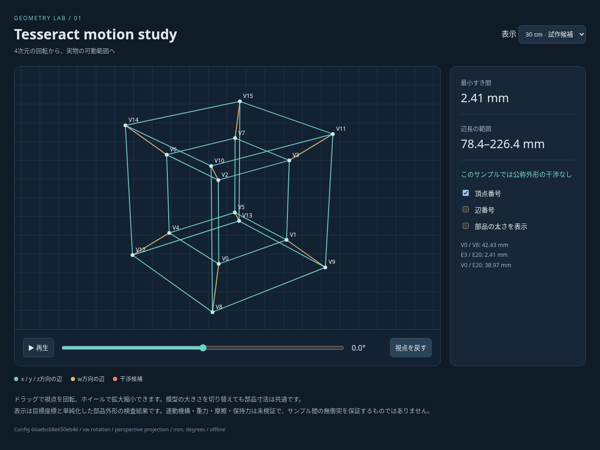
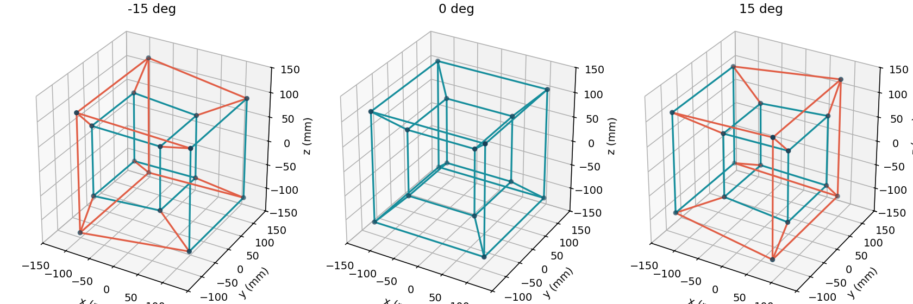
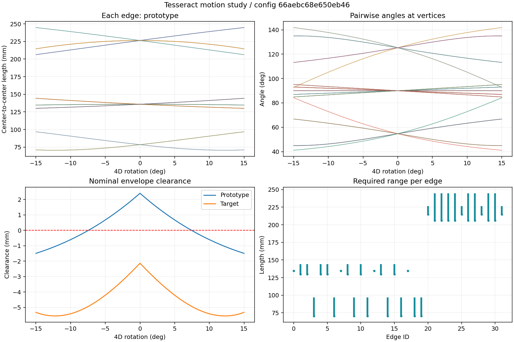
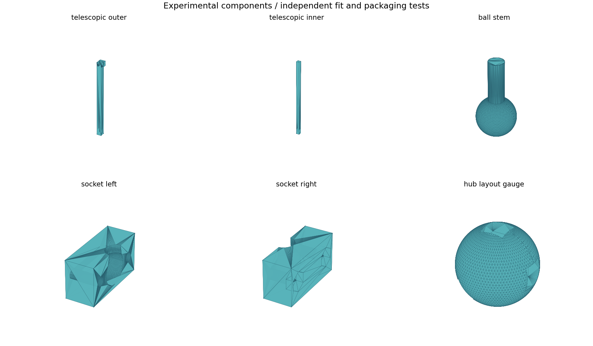

# 生成例と検証結果

設定ID: `66aebc68e650eb46`。`config/default.toml`から生成した結果。

[データ・オフラインビューア・試作用CAD一式](default-pack.zip)をダウンロードし、展開した`viewer.html`をブラウザで開く。ネット接続やサーバーは不要。

## 候補区間の結果

| 模型外形上限 | 辺長範囲 mm | 公称外形の最小すき間 mm | 干渉候補サンプル | 二段伸縮の収納・ストローク適合 |
| --- | --- | --- | --- | --- |
| 300 mm | 70.51–244.75 | -1.49 | 152/301 | 24/32 |
| 150 mm | 30.45–105.69 | -5.55 | 301/301 | 12/32 |

全周は1°、候補-15°〜15°は0.1°刻み。部品寸法は両サイズで共通。

試作サイズの公称外形で干渉がなかった連続サンプル群は-7.4°〜7.4°。サンプル間の無衝突を保証しない。局所の締付けボス・ねじを含めた保守的な再検査の結果は、ZIP内の`cad/manifest.json`に記録している。

生成した二段伸縮試験片はE21に対応。球面接続を1方向で傾斜させた検査では、干渉なしの検査角度は[0, 5, 10]°、干渉ありは[15, 20, 25, 30, 35, 40, 45, 50, 55, 60, 65]°。4辺ハブは静的な配置ゲージで、可動ハブではない。

## まだ成立していないこと

- 全32辺の二段伸縮収納、全体の連続可動、必要なジョイント自由度・可動域。
- ボスと締結部の実配置を反映した干渉解消。
- 材料・加工方式の確定、摩擦・保持力・強度・耐久性の実測。

寸法の詳細は[分析レポート](report.md)とZIP内のCSV・JSON、製作方法は[比較資料](../docs/manufacturing.md)を参照する。生成例は完成模型の製作承認や実測結果を意味しない。
